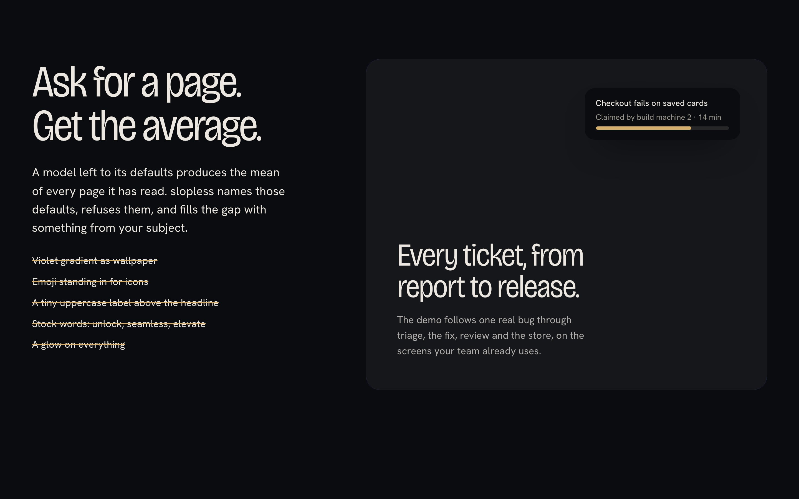
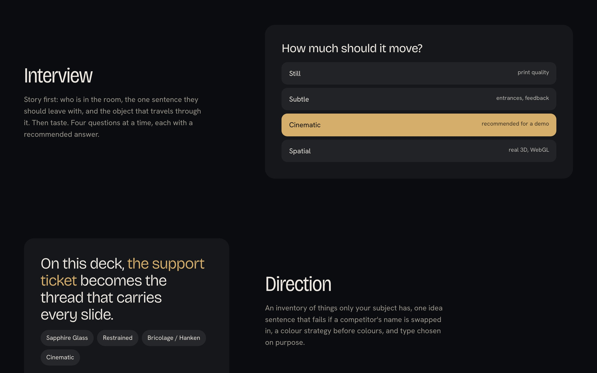
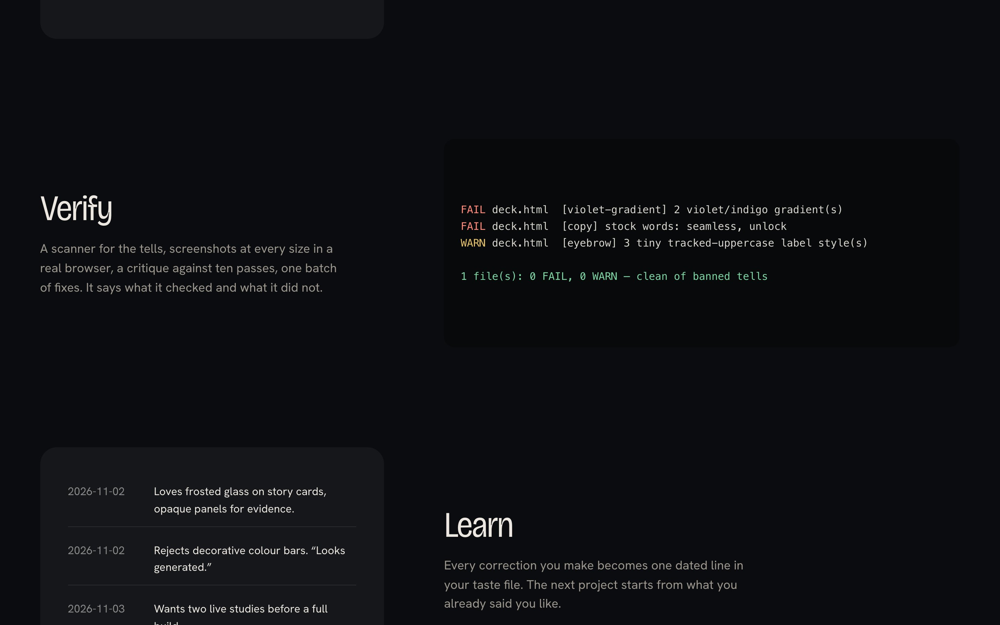
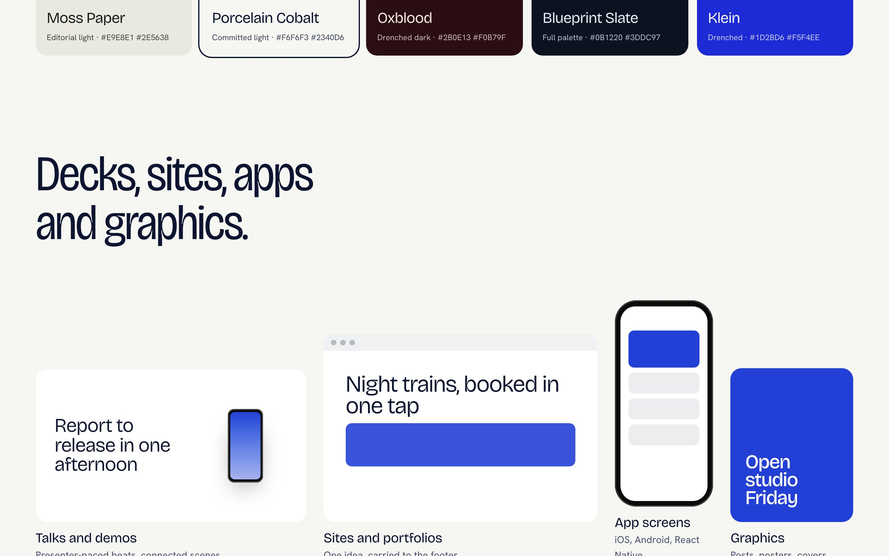

# slopless

An agent skill that makes Claude Code, Codex and other coding agents design like someone who decided every pixel: decks, landing pages, portfolios, app screens and graphics that don't look AI-made.


**Live showcase:** open [`docs/index.html`](docs/index.html). It's one self-contained file, built with the skill and checked by its own scanner.

## What it does

slopless works in six steps:

1. **Interview** — asks about the story first: who it's for, the one sentence they should leave with, and the object that travels through it. Then it asks about taste. It asks at most four questions at a time, and each one comes with a recommended answer.
2. **Direction** — lists things only your subject has, writes one idea sentence for the design, and picks a palette, type, layout and motion level.
3. **Prove** — on big jobs, builds two small live studies on your real content. You pick one before anything is fully built.
4. **Build** — sets the colour and type tokens first, then builds the opening, then every other part. GSAP, Three.js and WebGL motion are used only when the motion explains something.
5. **Verify** — a scanner checks for generated-design tells, it takes screenshots at every size in a real browser, scores them against a ten-pass critique, and fixes everything in one batch.
6. **Learn** — saves every correction you make to `~/.slopless/taste.md`, so the next project starts from your taste.

| | |
| --- | --- |
|  |  |
|  |  |

## Ten palettes

Each palette has a job and passes contrast checks. Pick one, rename it, or bring your own brand colours and slopless derives the rest of the palette.


| Vermilion | Glacier | Sapphire Glass |
| --- | --- | --- |
|  |  |  |

## Any surface

Talks and demo decks with presenter-paced beats, landing pages and portfolios, iOS / Android / React Native screens, and social posts or posters exported at exact sizes.



## Agents mode (opt-in)

Agents mode is off by default. On a big job, slopless offers it once and you choose how many helpers to use, from one to four: builder(s), a motion/3D builder, and a reviewer + visual QA. Mechanical work runs on cheaper models. Only the lead and the signature move use the top tier.


## How to prompt it

```text
Use slopless. I'm giving a 15-minute talk to our platform team on how we cut release time. Here's my outline.
Use slopless to redesign this landing page. Keep every word. It looks like every other AI site.
slopless, three Instagram posts announcing our beta, Porcelain Cobalt, 1080×1350.
Use slopless in agents mode with three helpers. Rebuild the deck in the Sapphire Glass direction.
Use slopless to review this screen. Why does it look generated?
```


## Install

```sh
# any agent that supports skills
npx skills add kundan0907/slopless

# or by hand
git clone https://github.com/kundan0907/slopless
cp -r slopless/slopless ~/.claude/skills/     # Claude Code
cp -r slopless/slopless ~/.agents/skills/     # Codex and others
```

Optional, for the screenshot step: `npm i -D playwright && npx playwright install chromium`.

## Tools in the skill

```sh
node slopless/scripts/slop-scan.mjs <files|dir>     # FAIL/WARN on violet gradients, gradient text, emoji icons, stock copy, eyebrows, glows…
node slopless/scripts/shoot.mjs page.html --deck --steps 12   # screenshots for review
node slopless/scripts/contrast.mjs '#ECE8E1' '#0B0C0F'        # WCAG ratio
node --test slopless/scripts/test/slop-scan.test.mjs
```

Wrap deliberate bad examples in `<!-- slopless-ignore-start -->` … `<!-- slopless-ignore-end -->`.

## How it stays light

`SKILL.md` is a short router. Each step loads only its own reference file (interview, direction, palettes, type, layout, motion, craft floor, copy, tells, review, memory, agents, plus one file per surface), so a small fix never pulls in the whole library.

## Repository

```
slopless/            the skill (copy this folder)
  SKILL.md
  references/        loaded on demand
  scripts/           slop-scan, shoot, contrast (+ tests)
showcase/            source of docs/index.html (npm i && npm run build)
docs/                the built showcase and README images
```

## Credits

slopless adapts ideas, in its own words, from [Impeccable](https://github.com/pbakaus/impeccable) (Apache-2.0), [taste-skill](https://github.com/leonxlnx/taste-skill) (MIT) and [UI/UX Pro Max](https://github.com/nextlevelbuilder/ui-ux-pro-max-skill) (MIT). See [NOTICE](NOTICE). The showcase uses Three.js (MIT), GSAP (free under its standard licence), and Bricolage Grotesque and Hanken Grotesk (SIL OFL 1.1).

MIT licensed.
