# slopless

Build websites, app screens, decks and graphics from scratch, or improve an existing UI. A design skill for Claude Code, Codex and other coding agents.

## Get started

Run this in your project and choose your coding agent when prompted:

```sh
npx skills add kundan0907/slopless
```

Then mention **slopless** in your request:

```text
Use slopless quick. Improve this UI. Keep its content and working behavior.
```

Starting fresh? Try: `Use slopless. Build a portfolio website for a product designer.`

The [installer](https://github.com/vercel-labs/skills#install-a-skill) requires Node.js 22.20+. See [manual installation](#install) for other options.

[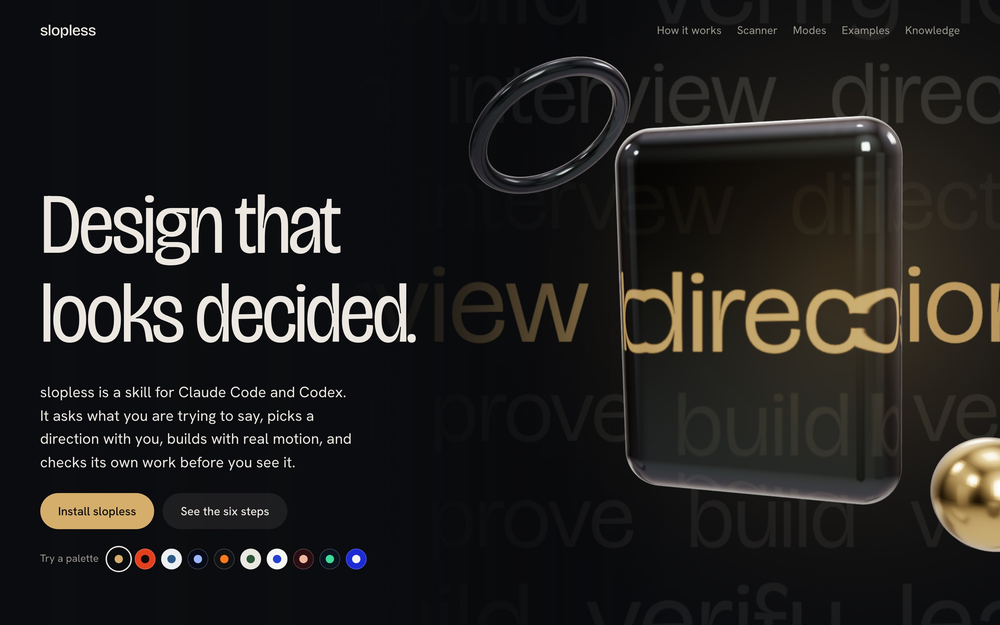](https://kundan0907.github.io/slopless/)

**[Open the live showcase →](https://kundan0907.github.io/slopless/)** A short page: what slopless does, a before and after you can drag, the palettes, and how to install it.

**[Open the toolbox →](https://kundan0907.github.io/slopless/explore.html)** The interview simulator, what your agent reads, modes explorer, assets, more examples, the knowledge base and a prompt cookbook, all running in your browser.

Each page is one self-contained file (`docs/index.html`, `docs/explore.html`), built with the skill and checked by its own scanner.

## What it does

The agent reads the content, audience and task before designing. Clear hierarchy and purposeful interaction come first. It reuses your components, sources suitable implementations from libraries such as Kokonut UI and shadcn/ui, and builds custom pieces where needed. Generic taglines, redundant helper text and secondary labels are cut when editing is allowed; supporting text and tables stay when they serve the user. Changes should improve UX, DX and AX together while preserving content and working behavior.

That does not prescribe a minimal look. Rich 3D, glass and cinematic motion remain valid design choices, including in this project's showcase. The user's design language and intent control the expression.

Choose a route, or let the request choose it:

- **Quick** is the default for existing work: “Use slopless quick. Make this a better V2.” It inspects the source and rendering, makes a clear visual upgrade through up to three high-impact changes, preserves content and working controls, and verifies one repair batch. No default interview, new engine, asset downloads or scoring essay.
- **Standard** is for new work or an explicit redesign. It first interviews you: a few A–D questions tailored to your brief, each with a recommended pick (narrative, motion, reference feel from [curated sites](slopless/references/sites.md), brand colours and palette, who owns the copy). Then it proves the opening and densest view on real content, builds and checks the result. Say "you pick" to skip ahead.
- **Deep** is explicit exploration, detailed audit or complex storytelling and motion. It loads the extra guidance needed for that job; helpers remain opt-in.
- **Review** reports findings without editing.

All routes retain the same craft: clear hierarchy, composition that explains the information, readable evidence, accessible interactions, appropriate motion and exact source preservation. Quick reduces setup and repeated work while retaining the design bar and respecting the requested scope. Runtime depends on content and the environment; no fixed speed or token saving is promised.

Every task has a design owner: understand the intent, choose the visual intervention, and judge the rendering. One agent handles design and implementation by default; separate helpers remain opt-in. A small request receives the same contextual judgment within its scope. Broad UI improvements must visibly improve hierarchy, composition, readability or interaction; cosmetic substitutions alone do not establish success.

Visual changes use three gates: inspect the current view, inspect a representative early result, then compare the final result at the same viewport and state. The agent captures or views the work automatically. Existing current evidence can be reused; nonvisual changes need no screenshot ritual. See [visual evidence and capture](slopless/references/browser.md#when-to-view-or-capture).

Every run ends with a [report](slopless/references/report.md) that doubles as the PR description: your choices, what changed, every content change shown before → after, and what was and was not verified.

The [router](slopless/SKILL.md) explains the workflow. [Quick](slopless/references/quick.md), [storytelling](slopless/references/storytelling.md), [visual quality](slopless/references/visual-quality.md) and [browser setup](slopless/references/browser.md) provide the relevant details.

## Try it in the toolbox

The [explore page](https://kundan0907.github.io/slopless/explore.html) is interactive. Everything runs in the browser from the single HTML file; nothing is uploaded.

**Interview simulator.** A handful of plain questions (one optional sentence, everything else a tap) ending in "Here is the prompt to paste into your agent". The palette and motion level you pick apply to the page.

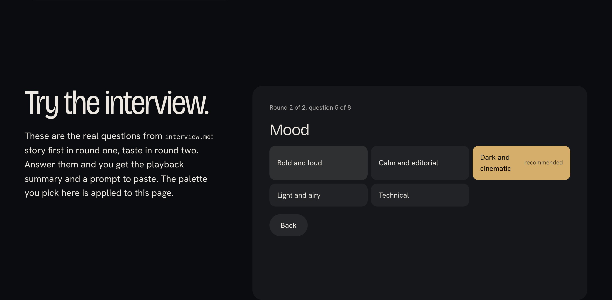

**What your agent reads.** Pick a job (deck, landing page, app screen, graphic, review) and see representative files for that route: the SKILL.md router, the surface and references, the scripts it runs. The excerpts are cut from the real files at build time and link to GitHub.

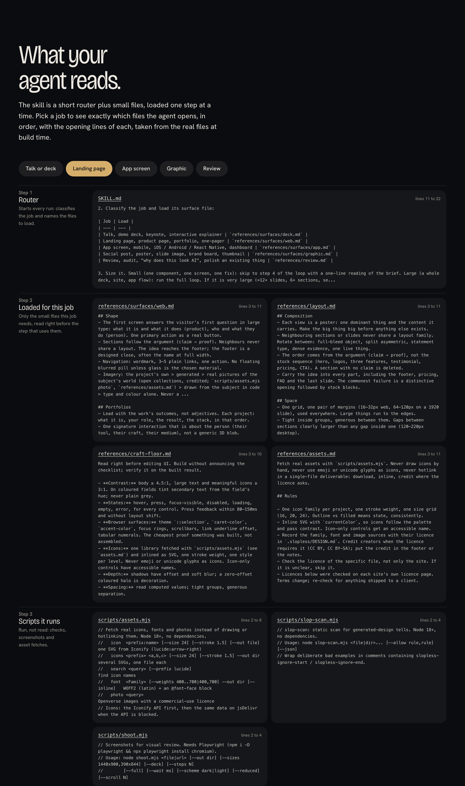

**Assets.** Icon sets from four families (fetched at build time with `assets.mjs` and inlined), a CSS device frame from real dimensions, and every source with its licence.

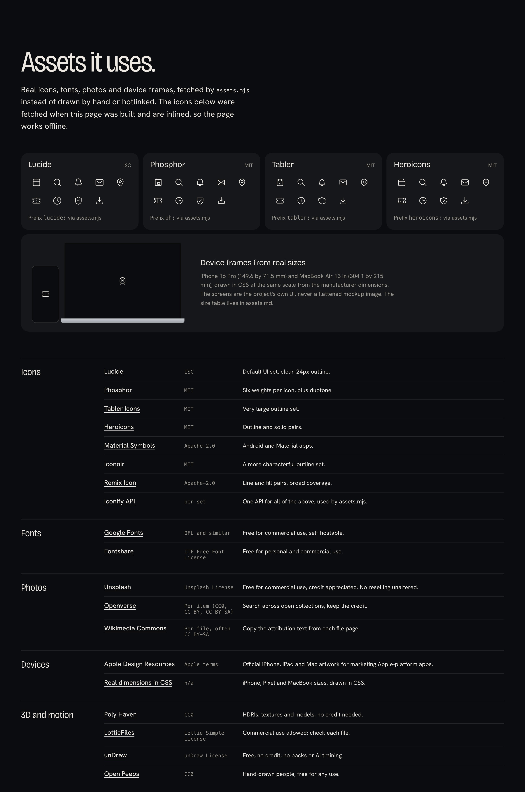

**Modes explorer.** Run modes (Quick, Standard, Deep), surfaces (deck, web, app, graphic), review modes (review, bolder, quieter, distill, harden), motion levels (still, subtle, cinematic, spatial: picking one re-runs a shared scene with a card, a device and a ticket in that level, in the interview, here and in the design-language section, and the choice is saved), agents mode and taste memory. Each shows what it does, what triggers it, an example prompt and the reference files it loads.

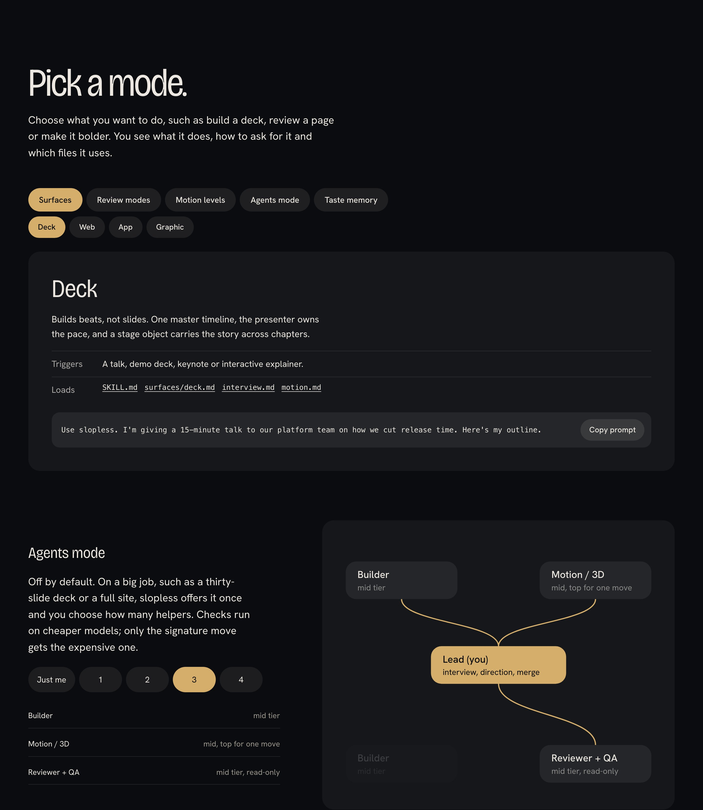

**Examples.** A deck slide, a landing hero, an app screen on a phone with real proportions and a social post, each built twice in HTML and CSS. Drag the handle, or use the arrow keys, to compare the generated look with the decided one in the current palette.

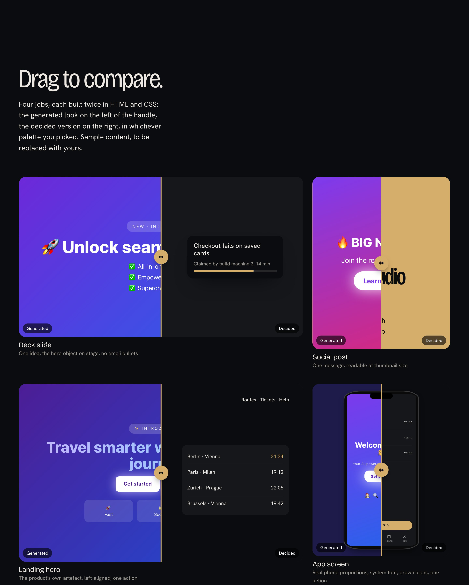

**How it differs.** What slopless adapted from Impeccable, taste-skill and UI/UX Pro Max (taken from NOTICE), and what it adds, each linked to the file that defines it. It is not a benchmark.

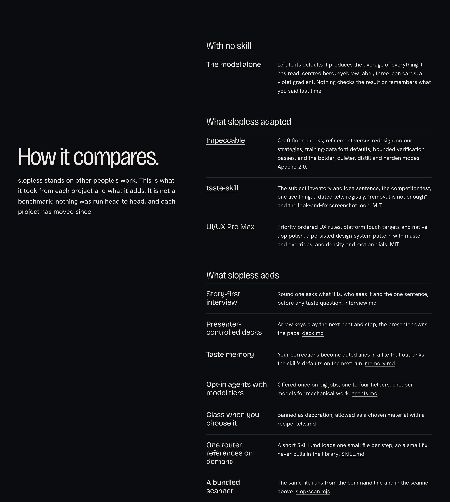

**Knowledge base, inspirations and prompts.** Every reference file and script with a one-line summary and a GitHub link (filterable), the galleries, effect libraries and reading from `inspiration.md`, and a cookbook of prompts with copy buttons.

## Ten palettes

Each palette has a job and passes contrast checks. Pick one, rename it, or bring your own brand colours and slopless derives the rest of the palette.

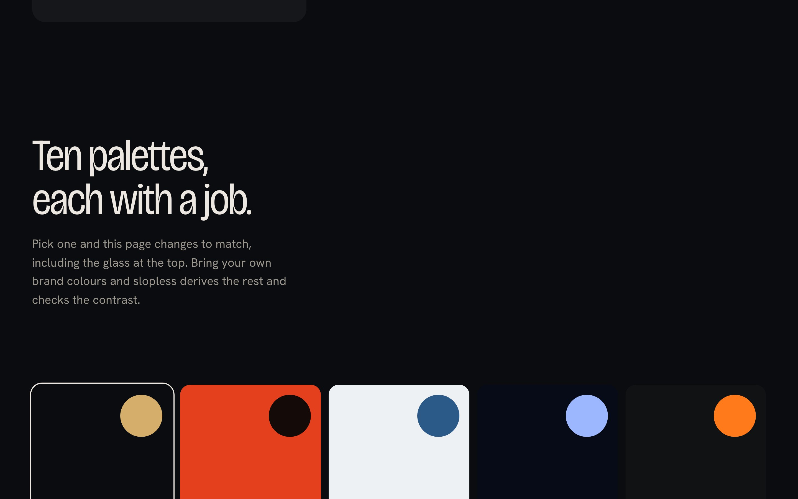

| Vermilion | Glacier | Sapphire Glass |
| --- | --- | --- |
| 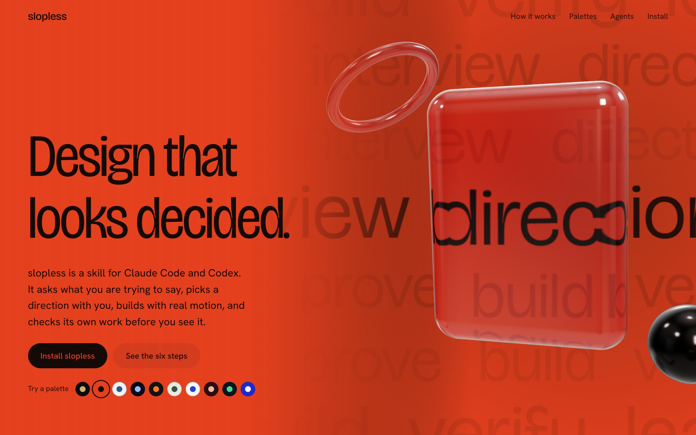 | 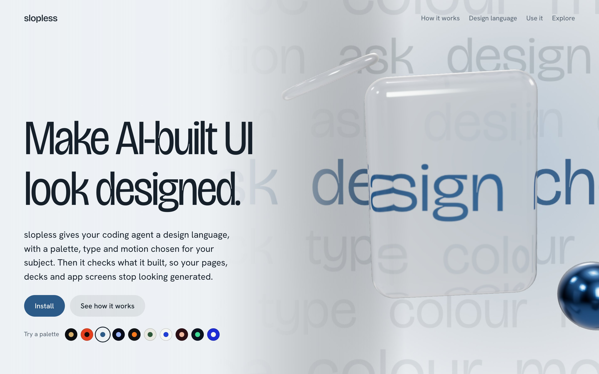 | 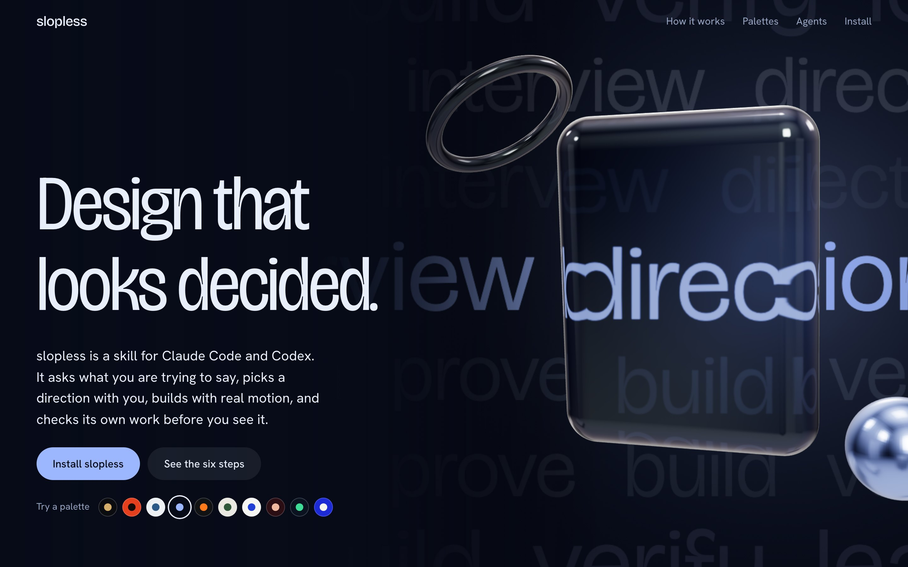 |

## Any surface

Talks and demo decks with presenter-paced beats, landing pages and portfolios, iOS / Android / React Native screens, and social posts or posters exported at exact sizes.

## Agents mode (opt-in)

Agents mode is off by default. On a big job, slopless offers it once and you choose how many helpers to use, from one to four: builder(s), a motion/3D builder, and a reviewer + visual QA. Mechanical work runs on cheaper models. Only the lead and the signature move use the top tier.

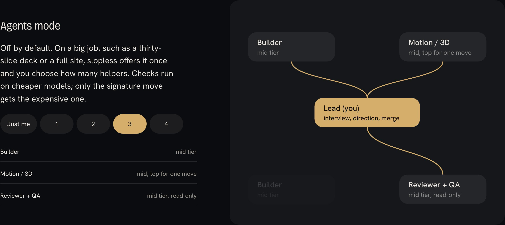

## How to prompt it

```text
Use slopless quick. Improve this HTML deck into V2. Keep every word, number, image and working control.
Use slopless. I'm giving a 15-minute talk to our platform team on how we cut release time. Here's my outline.
Use slopless to redesign this landing page. Keep every word. It looks like every other AI site.
slopless, three Instagram posts announcing our beta, Porcelain Cobalt, 1080×1350.
Use slopless in agents mode with three helpers. Rebuild the deck in the Sapphire Glass direction.
Use slopless to review this screen. Why does it look generated?
```

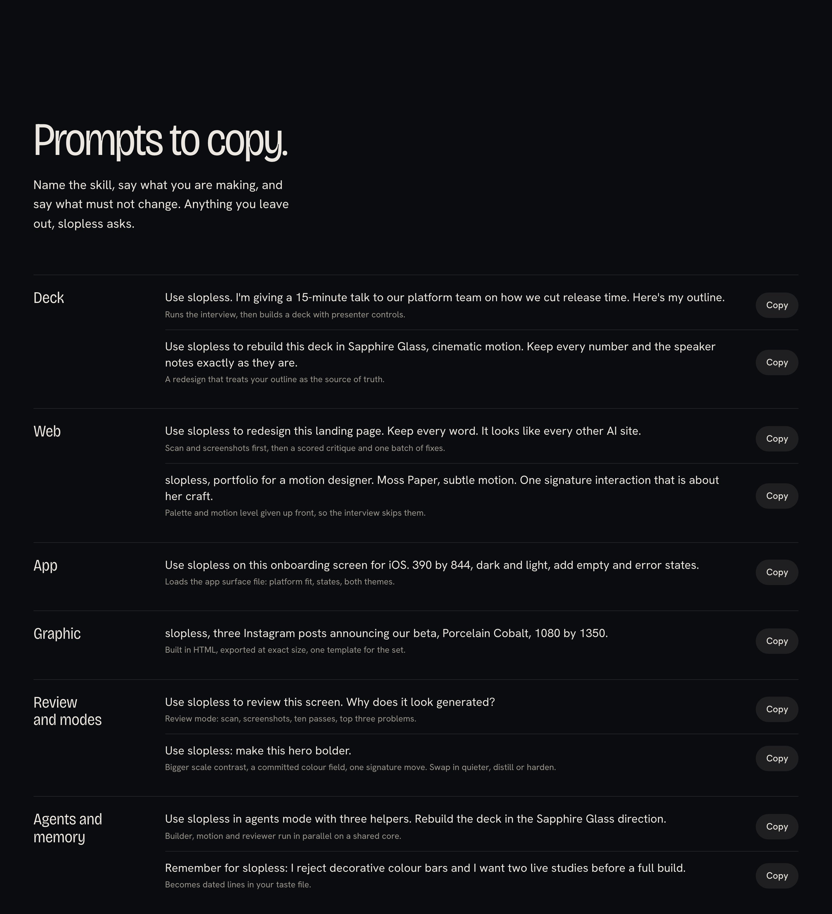

## Install

```sh
# Claude Code plugin (recommended for Claude Code: updates through /plugin)
/plugin marketplace add kundan0907/slopless
/plugin install slopless@slopless

# any agent that supports skills
npx skills add kundan0907/slopless

# or by hand
git clone https://github.com/kundan0907/slopless
mkdir -p ~/.claude/skills ~/.agents/skills
cp -r slopless/slopless ~/.claude/skills/     # Claude Code
cp -r slopless/slopless ~/.agents/skills/     # Codex and others
```

### Updating

- Claude Code plugin: run `/plugin`, open **Marketplaces → slopless → Enable auto-update** once; new commits then arrive automatically at session start. Manual: `/plugin marketplace update slopless`.
- `npx skills` installs: `npx skills update slopless`.
- Manual copies: `git pull` and copy the folder again.

No manual project setup after installing the skill: the agent uses its available browser tools first. The optional screenshot CLI uses Node 20+ and npm. On first use it provisions pinned Playwright and Chromium into user caches, leaving your project's dependencies unchanged. Downloads need network access and a supported OS; cached capture can work offline. `--no-install` prevents downloads. Without a usable browser, it reports visual verification as unavailable.

The scanner, asset fetcher and contrast helper use Node 18+ built-ins. New assets need network access; existing offline assets stay local. No API key is required. See [browser setup and failure handling](slopless/references/browser.md).

## Tools in the skill

```sh
node slopless/scripts/slop-scan.mjs <files|dir>     # FAIL/WARN on violet gradients, gradient text, emoji icons, stock copy, eyebrows, glows…
node slopless/scripts/shoot.mjs page.html --quick             # focused capture; setup handled automatically
node slopless/scripts/shoot.mjs deck.html --deck --steps 12   # 12 advances, not 12 slides
node slopless/scripts/shoot.mjs post.html --sizes 1080x1350   # exact pixel export
node slopless/scripts/contrast.mjs '#ECE8E1' '#0B0C0F'        # WCAG ratio
node slopless/scripts/assets.mjs icon lucide:arrow-right --size 24 --stroke 1.5   # real SVG from Iconify
node slopless/scripts/assets.mjs icons lucide arrow-right,check --out ./icons
node slopless/scripts/assets.mjs search arrow --prefix lucide
node slopless/scripts/assets.mjs font "Hanken Grotesk" --weights 400..700 --out ./fonts [--inline]
node slopless/scripts/assets.mjs photo "night train"          # Openverse, commercial-use licences
node --test slopless/scripts/test/*.mjs
SLOPLESS_BROWSER_TESTS=1 node --test slopless/scripts/test/deck-browser.test.mjs  # cached browser required
```

Wrap deliberate bad examples in `<!-- slopless-ignore-start -->` … `<!-- slopless-ignore-end -->`.

## How it stays light

`SKILL.md` routes before loading the library. Quick reads its compact guide and relevant source; specialist references are conditional. Agents search before reading, skip embedded vendor/base64 content, patch shared styles and reuse assets and navigation. Scripts run without loading their implementations into the conversation. Taste memory records explicit user choices; inferred design decisions stay project-specific.

The optional [deck controller](slopless/assets/deck-controller.js) gives new standalone decks cancellable transitions, beat navigation, readiness signals, reduced motion and print restoration without a framework or animation package. Quick keeps the existing engine.

Verification checks label–value–unit relationships per section; global word counts are insufficient. Screenshots record hashes and optional beat IDs in `capture.json`. A static scan cannot establish design quality. [Playwright provisioning](https://playwright.dev/docs/browsers) defines browser prerequisites; the craft floor follows [WCAG contrast guidance](https://www.w3.org/TR/WCAG22/#contrast-minimum) and [reduced-motion guidance](https://www.w3.org/WAI/WCAG22/Techniques/css/C39).

## Repository

```
slopless/            the skill (copy this folder)
  SKILL.md
  references/        loaded on demand
  scripts/           slop-scan, shoot, contrast, assets, cached browser runtime (+ tests)
  assets/            optional dependency-free deck controller
showcase/            source of docs/index.html and docs/explore.html (npm i && npm run build)
docs/                the two built pages and README images
```

## Before and after

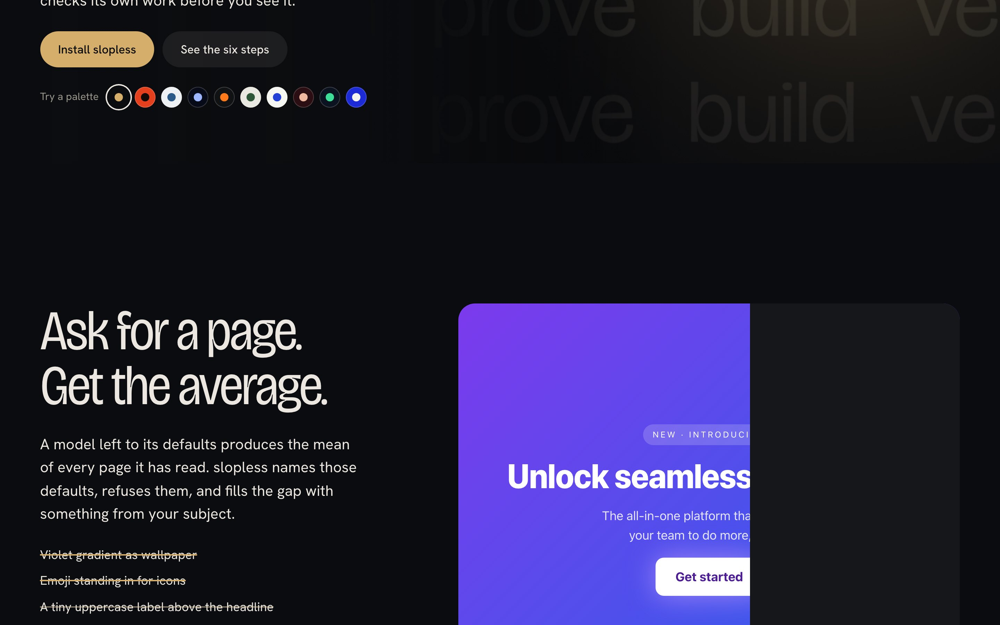

[Drag the live comparison](https://kundan0907.github.io/slopless/#before-after).

## Credits

slopless adapts ideas, in its own words, from [Impeccable](https://github.com/pbakaus/impeccable) (Apache-2.0), [taste-skill](https://github.com/leonxlnx/taste-skill) (MIT) and [UI/UX Pro Max](https://github.com/nextlevelbuilder/ui-ux-pro-max-skill) (MIT). See [NOTICE](NOTICE). The showcase uses Three.js (MIT), GSAP (free under its standard licence), and Bricolage Grotesque and Hanken Grotesk (SIL OFL 1.1).

MIT licensed.
